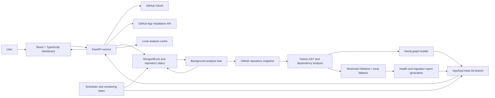

# RepoHeal architecture

## System overview

## Request and analysis lifecycle

1. **Authentication and authorization:** A user authenticates through GitHub OAuth. Repository actions validate access with the user's GitHub token and require the RepoHeal GitHub App to be installed on the target repository. Installation tokens are used for app-level repository operations.
2. **Target selection:** The dashboard retrieves repository branches and recent commits. The analysis request identifies `latest`, `branch`, or `commit` mode and passes an optional branch and exact commit SHA.
3. **Job registration:** The API creates a job and repository status record in MongoDB, then schedules the analysis task with FastAPI `BackgroundTasks`. Progress is written to MongoDB and delivered to the browser over Server-Sent Events.
4. **Repository scan:** The worker downloads the requested snapshot, scans Python files with `ast`, derives import and symbol relationships, extracts supported Python dependency manifests, compares imports to declarations, and requests latest package versions from PyPI.
5. **Graph construction:** The worker builds file, namespace/package, function, class, and relationship graph data in Neo4j when connected. The graph API can generate a Cytoscape-shaped response from the local cached analysis. For a selected historical analysis, it can generate a graph from the saved analysis record and cache that graph snapshot on `repoheal.meta`.
6. **Migration analysis:** Local deprecation patterns and version-gap checks produce and persist a preliminary health score before the external intelligence request begins. Fingerprints are then correlated with the configured provider in batches of at most five libraries, with at most two batches in flight per analysis. The Webtool client's HTTP timeout is 300 seconds; identical concurrent requests are coalesced behind its in-flight lock. External results enrich the health score, risk assessments, impacts, recommendations, and migration document. The report records whether external intelligence succeeded, degraded, or failed so missing provider data is not confused with a clean verified result.
7. **History and comparison:** Each analysis receives an ID containing the selected branch, short commit SHA, and UTC timestamp. The manifest indexes analysis, graph, health, migration, and comparison artifacts on `repoheal.meta`.

The repository dashboard exposes two task actions. **Analyze repository** runs the scan, graph construction, and health/migration pipeline for the selected target. **Refresh health & migration** invokes the health-refresh job against a saved analysis, skipping the source scan. Both use the repository job status record and SSE progress; the browser also polls the status endpoint every ten seconds to recover from a missed SSE event. Once the preliminary score is saved, the worker emits a progress update and the browser reloads Reports while the external lookup continues. At task completion, the report, graph, and dashboard are reloaded again. The Reports page shows active and failed task states with the worker message and percentage. Graph filters normalize node types and package metadata so older saved package nodes remain filterable. PNG rendering assigns fallback positions to nodes with no parent path to the repository root.

## Persistence boundaries

| Data | Store | Role |
| --- | --- | --- |
| OAuth sessions and encrypted tokens | MongoDB | Authenticated session state |
| Jobs and current repository status | MongoDB | Queue deduplication, progress, completion, failure, and recovery |
| Alerts, health snapshots, watchlists, and schedules | MongoDB | Operational monitoring state |
| Aggregated operational metrics | MongoDB | Admin metrics; values are persisted when recorded by worker events |
| Analysis snapshots, graph snapshots, reports, history manifest | GitHub `repoheal.meta` branch | Durable per-repository analysis history |
| Downloaded source snapshots and local analysis cache | `.repoheal_cache/` | Temporary working data subject to configured cache governance |
| Live nodes and relationships | Neo4j | Graph query/storage backend; graph API can fall back to local analysis cache or saved graph snapshots |

Analysis/report artifacts are committed to the metadata branch, not to the user's source branch. Source-code change branches are a separate remediation workflow.

## Main code areas

| Path | Responsibility |
| --- | --- |
| `app/routers/` | FastAPI routes for auth, dashboard, analysis, reports, graph, monitoring, admin, webhooks, and repository data |
| `app/analysis/` | AST scanning, fingerprints, dependency parsing, package normalization, impact analysis, and risk scoring |
| `app/intelligence/` | External Webtool client, correlation, and local deprecation fallback |
| `app/graph/` | Neo4j connectivity, graph building, and graph rebuilding |
| `app/reports/` | Health report generation and serialization |
| `app/migrations/` | Migration documents, compatibility shims, transforms, and approval workflows |
| `app/github/` | GitHub OAuth/App integration, repository access, and metadata-branch persistence |
| `app/worker/` | Analysis job lifecycle, progress tracking, metric recording, and scheduler/monitor tasks |
| `app/storage/` | Local structured analysis artifacts and cache snapshots |
| `frontend/src/` | React dashboard, typed API client, graph/report views, and user controls |

## Operational behavior and limits

- The analyzer is Python-focused: source syntax and API fingerprints are derived from Python AST scans. Dependency declarations are read from supported Python packaging formats; this is not a language-agnostic static analyzer.
- Package version data depends on PyPI availability. Symbol-level migration data depends on the configured Restricted Webtool and its reachable knowledge sources. Fallback behavior is recorded in the report; missing external intelligence should not be described as full API verification.
- Neo4j is optional for the API to start. Graph availability can be reduced when Neo4j is down and no readable cache/metadata snapshot exists.
- MongoDB is required for authenticated sessions and persistent job state. Durable report history is stored in GitHub metadata artifacts.
- Background tasks run in the FastAPI service process. Deployments that require durable distributed queues or multi-worker orchestration would need a dedicated task queue; this repository currently uses FastAPI background tasks and MongoDB state.
- Render's free service may sleep and local filesystem data may be ephemeral. The `repoheal.meta` branch is the durable artifact path for analysis and report history.

## API surface

Use `/docs` for the generated OpenAPI definition. Core routes include:

- `/auth/*` and `/dashboard/data` for sign-in and repository discovery.
- `/repos/{owner}/{repo}/branches` and `/commits` for target selection.
- `/analyze/{owner}/{repo}`, `/reanalyze/{owner}/{repo}`, `/health-refresh/{owner}/{repo}`, and `/jobs/*` for analysis jobs.
- `/sse/status/{owner}/{repo}` for streamed job progress.
- `/graph/{owner}/{repo}`, `/status/{owner}/{repo}`, `/graph/rebuild/{owner}/{repo}`, and `/visualize/{owner}/{repo}/export.png` for graph data/status/export.
- `/reports/{owner}/{repo}/{health|migration|history|compare|export}` for saved reports and historical views.
- `/monitor/*` for health history, watchlists, alerts, rules, schedules, and monitoring dashboard.
- `/admin/metrics` and `/admin/observability` for restricted persisted operational metrics and live dependency checks.
